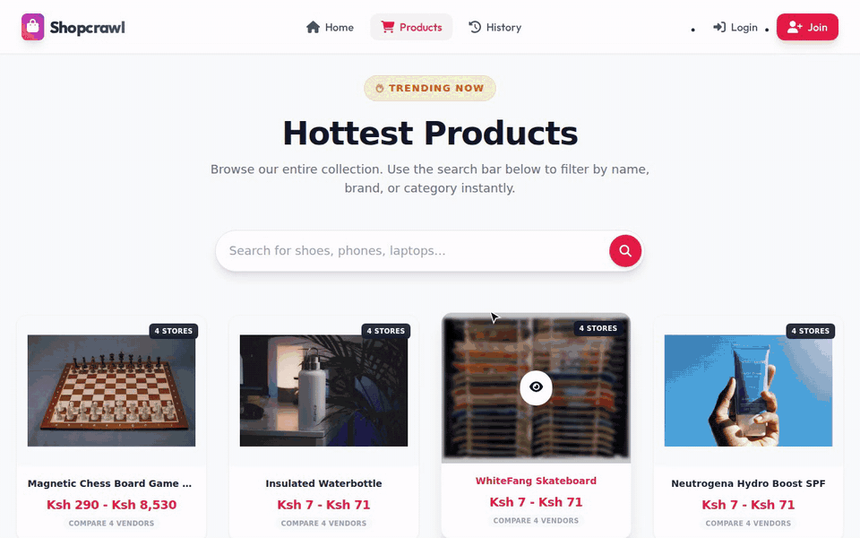
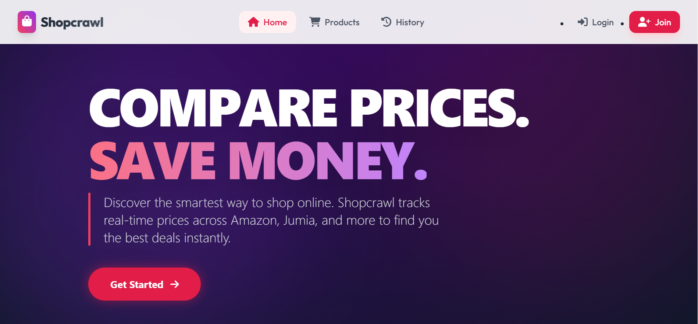
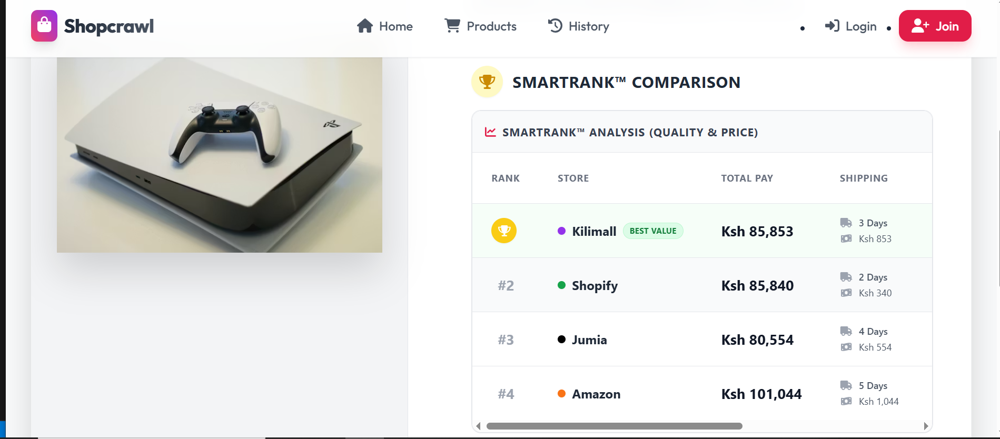
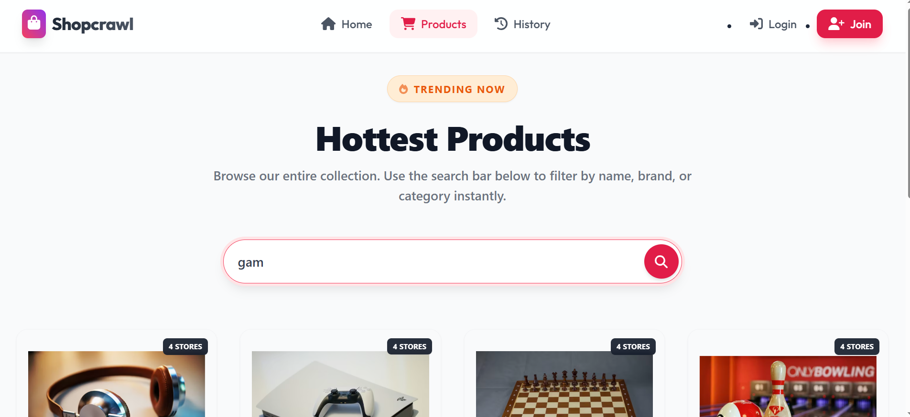
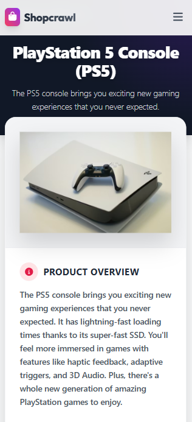

<div align="center">

# 🛍️ ShopCrawl

### Four stores. One search. Zero open tabs.

**A price-comparison engine that ranks Amazon, Jumia, Kilimall and Shopify offers by what you actually pay, not just the sticker price.**

[](https://shopcrawl-frontend.onrender.com/)
[](https://github.com/JessyWaweru/shopcrawl-web)


<sub>⏳ Free-tier hosting: the first request may take ~45s while the server wakes up. Worth the wait, promise.</sub>

</div>

<p align="center">
  
</p>

---

## 🤔 The problem

Shopping online in Kenya means juggling Jumia, Kilimall and Amazon in separate tabs, then doing mental maths on shipping fees, delivery times and whether that "4.1-star" seller is legit.

**ShopCrawl does the maths for you.** Search once, then let **SmartRank™** tell you which store is the best deal overall.

## 🧮 SmartRank™: an actuary's take on "best deal"

I studied Actuarial Science, so "cheapest" was never going to be the whole story. SmartRank scores every store on three weighted factors:

| Factor | Weight | How it's scored |
|---|:---:|---|
| 💰 **Total cost** (price + shipping) | 45% | `cheapest_total / store_total × 100` |
| ⭐ **Trust** (store rating /10) | 35% | `rating / 10 × 100` |
| 🚚 **Speed** (delivery days) | 20% | `fastest_days / store_days × 100` |

…and then a **20% risk penalty** for any store rated below 6/10, because a cheap item that never arrives isn't cheap.

On the backend, every product also carries an `expected_value` and a `risk_adjusted_score` (*expected value minus a variance penalty*), and the API returns products sorted by that score by default.

## 📸 Screenshots

| 🏠 Home | 🏆 SmartRank |
|:---:|:---:|
|  |  |
| 🔍 **Search** | 📱 **Mobile** |
|  |  |

## ✨ Features

- 🔍 **Multi-vendor search**: one query across four stores (`?search=iphone`)
- 🏆 **Risk-adjusted ranking**: products ordered by `risk_adjusted_score` out of the box
- 🔐 **Token auth**: email-based login, PBKDF2-hashed passwords, PIN-based password recovery
- 📜 **Recently viewed**: the last 11 products you opened, de-duplicated automatically
- 📱 **Mobile-first UI**: React + Tailwind, with toast feedback on every action

## 🏗️ Architecture

```
┌──────────────────┐   REST / JSON   ┌───────────────────────┐      ┌──────────────┐
│  shopcrawl-web   │ ──────────────▶ │    shopcrawl-api      │ ───▶ │  PostgreSQL  │
│  React+Tailwind  │ ◀────────────── │  Django REST Framework │      │  (SQLite dev)│
└──────────────────┘   Token auth    └───────────────────────┘      └──────────────┘
        Render                         Gunicorn + WhiteNoise
```

## 📡 API at a glance

| Method | Endpoint | What it does | Access |
|:---:|---|---|:---:|
| `GET` | `/api/products/?search=…&ordering=…` | Search & rank products | 🌍 |
| `POST` | `/api/users/` | Sign up | 🌍 |
| `POST` | `/api/login/` | Log in, get a token | 🌍 |
| `POST` | `/api/reset-password/` | Reset with your recovery PIN (rate-limited) | 🌍 |
| `GET` `PATCH` | `/api/users/{id}/` | Your own profile only | 🔐 |
| `GET` `POST` | `/api/history/` | Read / add recently viewed | 🔐 |
| `POST` `PUT` `DELETE` | `/api/products/…` | Manage the catalogue | 🛡️ admin |

## 🔒 Security notes

- Passwords **and** recovery PINs are hashed; neither ever leaves the server
- Admin rights are granted server-side (`ADMIN_SIGNUP_CODE` env var), never trusted from the client
- Users can only read or edit their own account; the catalogue is read-only unless you're an admin
- Login and reset errors are deliberately vague, so they don't reveal which emails are registered

## 🚀 Run it locally

```bash
git clone https://github.com/JessyWaweru/shopcrawl-api.git
cd shopcrawl-api
python -m venv venv && source venv/bin/activate
pip install -r requirements.txt
python manage.py migrate
python manage.py runserver        # → http://127.0.0.1:8000/api/
```

Then start the [frontend](https://github.com/JessyWaweru/shopcrawl-web) with `npm install && npm start`.

## 🧪 Tests

```bash
python manage.py test -v 2        # auth flow + product search
```

---

<div align="center">

**Built by Jessy Bryan Waweru**: actuary by training, full-stack engineer by obsession.

[](https://www.linkedin.com/in/jessy-waweru-b8051a288)
[](mailto:bryanjessywaweru@gmail.com)
[](https://github.com/JessyWaweru)

</div>
